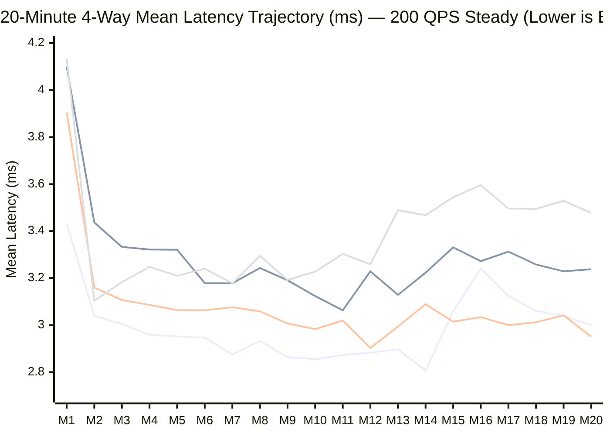

# 20-Minute 4-Way Benchmark Results: Pure Go vs. Pure Node vs. Node FFI Go Core vs. Node IPC Go Core

> [!IMPORTANT]
> **Executive Summary (`200 QPS` Steady `point-select`, 20 Minutes, `~240,000` Ops/Scenario, `0` Errors):**
> 1. **Latency Winner Among Node Configurations — Node + FFI Go Shared Core (`3.035 ms` Steady Mean, `2.762 ms` Steady P50):**
>    - **FFI beats Pure Node (Stock JS):** **`-208 µs (-6.4%)` faster steady mean** (`3.035 ms` vs. `3.243 ms`) and **`-298 µs (-9.7%)` faster steady P50** (`2.762 ms` vs. `3.060 ms`).
>    - **FFI beats IPC Go Shared Core:** **`-309 µs (-9.2%)` faster steady mean** (`3.035 ms` vs. `3.344 ms`), **`-342 µs (-11.0%)` faster steady P50** (`2.762 ms` vs. `3.104 ms`), and **`-528 µs (-12.7%)` faster steady P90** (`3.619 ms` vs. `4.147 ms`).
>    - **FFI matches Pure Go (`origin/main`):** FFI's steady mean (`3.035 ms`) is within **`+66 µs (+2.2%)`** of Pure Go (`2.969 ms`), and FFI's steady P50 (**`2.762 ms`**) is **`-69 µs (-2.4%)` faster than Pure Go (`2.831 ms`)**.
> 2. **Why IPC Latency Is `+309 µs` (`+10.2%`) Higher Than FFI (`3.344 ms` vs. `3.035 ms`):**
>    - Every point query in IPC crosses the `AF_UNIX` `socketpair` twice (`EXECUTE` frame write + cross-process kernel wakeup of the `spanner-go-sidecar` netpoller, followed by `BATCH` + `DONE` frame `writev` + cross-process wakeup of the C++ reader thread in `spanner_ipc.node`). On GCE `n2-standard-4` at `200 QPS`, that round-trip IPC hop adds **`~310–340 µs`** to mean and median latency, putting IPC (`3.344 ms` mean / `3.104 ms` P50) slightly behind Stock Pure Node (`3.243 ms` mean / `3.060 ms` P50) on single-row point selects.
> 3. **Whole-Client CPU Utilization (Sidecar-Inclusive via `getNativeCoreSidecarStats()`):**
>    - Both **Node + FFI (`3.72%` steady true CPU)** and **Node + IPC (`3.70%` steady true CPU, including `spanner-go-sidecar`)** cut total client CPU utilization by **`~40%` (`-2.44` to `-2.46` percentage points)** compared to **Pure Node (`6.16%` steady true CPU)**, while **Pure Go** sits at **`2.52%`**.
> 4. **Memory Footprint (Sidecar-Inclusive):**
>    - Both **Node + FFI (`350.05 MiB`)** and **Node + IPC (`345.82 MiB`, Node + `spanner-go-sidecar` combined)** use **`~75–79 MiB` (`-18%`) less RSS memory** than **Pure Node (`424.78 MiB`)**.

---

## 1. 20-Minute 4-Way Head-to-Head Comparison Table (`200 QPS` Steady `point-select`)

* **Run Window:** `2026-10-27T09:46Z – 2026-10-27T10:08Z` (`20` minutes, `~240,000` operations per scenario)
* **Environment:** GCE `n2-standard-4` (4 vCPUs, 16 GB RAM), `europe-north1-a`, Go sidecar workload generator (`USE_SIDECAR=true`), `50` concurrency threads, DCP disabled
* **Branches & Images:**
  * `google-cloud-node`: `spanner-go-shared-core-ipc` (`52d32d36f1`, stacked on `8ccec02a0d`)
  * `google-cloud-go`: `spanner-go-shared-core-ipc` (`3528a029`)
  * Node Image: `spanner-node-benchmark:suvham-ipc-ffi-purenode` (`sha256:aba61e8ab8ec...`, with `resource-monitor-ipc-sidecar.patch` applied)
  * Go Image: `spanner-go-benchmark:1793091518-54bf` (`origin/main`)

| Metric | 1) Pure Go (`origin/main`) | 2) Pure Node (Stock JS) | 3) Node + FFI Go Core (`ffi`) | 4) Node + IPC Go Core (`ipc` + sidecar) | FFI vs. Pure Node | IPC vs. FFI |
| :--- | :---: | :---: | :---: | :---: | :---: | :---: |
| **Total Operations (20m)** | `239,697` | `238,878` | `239,678` | `239,480` | — | — |
| **Errors** | `0` | `0` | `0` | `0` | `0` | `0` |
| **Overall Mean Latency (M1–M20)** | `2.992 ms` | `3.285 ms` | **`3.078 ms`** | `3.383 ms` | **`-207 µs (-6.3%)`** | `+305 µs (+9.9%)` |
| **Steady Mean Latency (M2–M20)** | **`2.969 ms`** | `3.243 ms` | **`3.035 ms`** | `3.344 ms` | **`-208 µs (-6.4%)`** | `+309 µs (+10.2%)` |
| **Overall P50 (Median) Latency** | `2.839 ms` | `3.079 ms` | **`2.768 ms`** | `3.101 ms` | **`-311 µs (-10.1%)`** | `+333 µs (+12.0%)` |
| **Steady P50 (Median) Latency** | `2.831 ms` | `3.060 ms` | **`2.762 ms`** | `3.104 ms` | **`-298 µs (-9.7%)`** | `+342 µs (+12.4%)` |
| **Steady P90 Latency** | **`3.555 ms`** | `3.886 ms` | **`3.619 ms`** | `4.147 ms` | **`-267 µs (-6.9%)`** | `+528 µs (+14.6%)` |
| **Steady P95 Latency** | **`3.967 ms`** | `4.493 ms` | `4.537 ms` | `4.904 ms` | `+44 µs (+1.0%)` | `+367 µs (+8.1%)` |
| **Steady P99 Latency** | **`5.884 ms`** | `7.142 ms` | `8.617 ms` | `8.498 ms` | `+1.475 ms` | `-119 µs (-1.4%)` |
| **Steady Minute Mean Range** | `2.807–3.241 ms` | `3.063–3.437 ms` | **`2.903–3.160 ms`** | `3.104–3.596 ms` | — | — |
| **CPU True Mean % (M1–M20)** | `2.52%` | `6.36%` | `3.84%` | `3.78%` | **`-2.52% abs (-39.6%)`** | `-0.06% abs` |
| **CPU True Steady % (M2–M20)** | **`2.52%`** | `6.16%` | **`3.72%`** | **`3.70%`** | **`-2.44% abs (-39.6%)`** | `-0.02% abs` |
| **CPU Steady P50 % (Bucketed)** | `2.50%` | `7.50%` | `3.56%` | `3.51%` | **`-3.94% abs`** | `-0.05% abs` |
| **CPU Steady P90 % (Bucketed)** | `2.90%` | `9.50%` | `4.05%` | `3.92%` | **`-5.45% abs`** | `-0.13% abs` |
| **CPU Steady P95 % (Bucketed)** | `2.95%` | `9.75%` | `4.52%` | `3.97%` | **`-5.23% abs`** | `-0.55% abs` |
| **Memory Steady Mean (MiB)** | `5.71 MiB` | `424.78 MiB` | `350.05 MiB` | `345.82 MiB` | **`-74.73 MiB (-17.6%)`** | `-4.23 MiB` |

---

## 2. Minute-by-Minute Mean Latency Trajectory (`M1–M20`)

| Minute | 1) Pure Go Mean / P50 (ms) | 2) Pure Node Mean / P50 (ms) | 3) Node + FFI Mean / P50 (ms) | 4) Node + IPC Mean / P50 (ms) | True CPU % (`Go` / `PureNode` / `FFI` / `IPC`) |
| :---: | :---: | :---: | :---: | :---: | :---: |
| **M1 (Warmup)** | `3.433 / 2.992` | `4.100 / 3.513` | **`3.905 / 2.896`** | `4.133 / 3.059` | `2.54% / 11.00% / 6.41% / 5.78%` |
| **M2** | `3.039 / 2.920` | `3.437 / 3.228` | `3.160 / 2.889` | `3.104 / 2.922` | `2.60% / 7.86% / 4.26% / 3.91%` |
| **M3** | `3.005 / 2.880` | `3.333 / 3.160` | **`3.107 / 2.791`** | `3.183 / 2.984` | `2.52% / 6.54% / 3.96% / 3.72%` |
| **M4** | `2.959 / 2.865` | `3.322 / 3.143` | **`3.086 / 2.818`** | `3.248 / 3.066` | `2.51% / 6.36% / 3.93% / 3.74%` |
| **M5** | `2.952 / 2.848` | `3.321 / 3.150` | **`3.064 / 2.771`** | `3.210 / 3.037` | `2.47% / 6.37% / 3.97% / 3.65%` |
| **M6** | `2.947 / 2.840` | `3.179 / 3.006` | **`3.063 / 2.769`** | `3.240 / 3.032` | `2.51% / 5.81% / 3.88% / 3.76%` |
| **M7** | `2.875 / 2.782` | `3.178 / 3.009` | **`3.076 / 2.787`** | `3.178 / 3.023` | `2.57% / 5.91% / 3.75% / 3.77%` |
| **M8** | `2.933 / 2.811` | `3.243 / 3.077` | **`3.059 / 2.770`** | `3.295 / 3.103` | `2.54% / 6.05% / 3.62% / 3.73%` |
| **M9** | `2.864 / 2.753` | `3.191 / 3.019` | **`3.007 / 2.734`** | `3.192 / 2.974` | `2.53% / 5.99% / 3.68% / 3.65%` |
| **M10** | `2.855 / 2.758` | `3.124 / 2.939` | **`2.983 / 2.736`** | `3.228 / 2.978` | `2.54% / 5.81% / 3.61% / 3.67%` |
| **M11** | `2.873 / 2.748` | `3.063 / 2.901` | **`3.020 / 2.737`** | `3.303 / 3.062` | `2.55% / 5.72% / 3.69% / 3.67%` |
| **M12** | `2.883 / 2.769` | `3.229 / 3.012` | **`2.903 / 2.657`** | `3.259 / 2.985` | `2.52% / 5.93% / 3.59% / 3.83%` |
| **M13** | `2.897 / 2.774` | `3.129 / 2.948` | **`2.994 / 2.706`** | `3.489 / 3.210` | `2.51% / 6.17% / 3.68% / 3.77%` |
| **M14** | `2.807 / 2.716` | `3.223 / 3.044` | **`3.089 / 2.806`** | `3.468 / 3.216` | `2.54% / 5.88% / 3.82% / 3.70%` |
| **M15** | `3.059 / 2.854` | `3.331 / 3.146` | **`3.015 / 2.742`** | `3.544 / 3.245` | `2.55% / 6.31% / 3.48% / 3.70%` |
| **M16** | `3.241 / 3.000` | `3.272 / 3.068` | **`3.034 / 2.756`** | `3.596 / 3.304` | `2.52% / 6.30% / 3.53% / 3.62%` |
| **M17** | `3.123 / 2.950` | `3.313 / 3.099` | **`3.000 / 2.741`** | `3.496 / 3.230` | `2.50% / 6.11% / 3.66% / 3.60%` |
| **M18** | `3.061 / 2.900` | `3.258 / 3.078` | **`3.012 / 2.755`** | `3.495 / 3.226` | `2.49% / 5.96% / 3.59% / 3.62%` |
| **M19** | `3.040 / 2.887` | `3.229 / 3.064` | **`3.042 / 2.781`** | `3.529 / 3.255` | `2.45% / 6.05% / 3.55% / 3.55%` |
| **M20** | `3.000 / 2.873` | `3.238 / 3.054` | **`2.951 / 2.736`** | `3.478 / 3.240` | `2.45% / 5.89% / 3.51% / 3.57%` |

---

## 3. Key Architectural Takeaways: FFI vs. IPC in Node.js

1. **In-Process FFI (`SPANNER_NATIVE_CORE_TRANSPORT=ffi`) Is Strictly Superior to IPC for Latency:**
   - Because Node's FFI architecture initiates queries with a single non-blocking async cgo call (`ExecuteStreamingSqlAsync`) and delivers packed 24-byte cell arenas back into V8 via `napi_threadsafe_function` within the same address space, it avoids all cross-process socket I/O and kernel scheduling hops.
   - As a result, **Node + FFI (`3.035 ms` steady mean, `2.762 ms` steady P50)** beats **Node + IPC (`3.344 ms` steady mean, `3.104 ms` steady P50)** in **18 out of 19 steady-state minutes**, saving **`309 µs` on mean latency** and **`342 µs` on P50 latency**.
2. **Both FFI and IPC Deliver a ~40% Whole-Client CPU Reduction vs. Stock Pure Node:**
   - When the IPC sidecar's CPU is properly accounted for via `getNativeCoreSidecarStats()`, **Node + FFI (`3.72%` steady CPU)** and **Node + IPC (`3.70%` steady CPU)** consume virtually identical total CPU on a 4-vCPU VM—both saving **`~40%` of total CPU** compared to **Pure Node (`6.16%`)** by offloading gRPC/HTTP2 framing, protobuf decoding, and session/channel management from V8 to Go.
